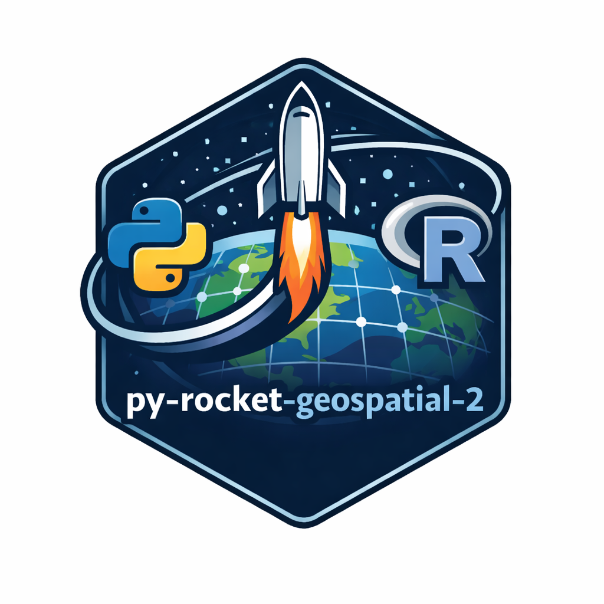

# py-rocket-geospatial-2

[](https://github.com/nmfs-opensci/py-rocket-geospatial-2) [](https://github.com/nmfs-opensci/py-rocket-geospatial-2/issues) [](https://doi.org/10.5281/zenodo.18557656) <br> [](https://github.com/nmfs-opensci/py-rocket-geospatial-2/releases) [](https://github.com/nmfs-opensci/py-rocket-geospatial-2/pkgs/container/py-rocket-geospatial-2)  

---

## What is py-rocket-geospatial-2?



**py-rocket-geospatial-2** is a Python–R geospatial Docker image for large-scale earth-science data analysis in JupyterHub environments.

It is designed for users working with large earth-observation datasets, especially cloud-native data, from organizations such as NOAA, NASA, and other public earth-science data providers. The image targets workflows common in cryoscience, oceanography, climate science, and remote sensing. It is optimized for:

- big-data, array-based analysis  
- cloud object storage and distributed computing  
- shared, multi-user JupyterHub deployments  

---

## py-rocket-geospatial-2 combines three ecosystems:

### Python (Pangeo-style big-data stack)
- Based on the Pangeo notebook environment  
- Designed for xarray/Dask-style workflows  
- Extended with additional geospatial and scientific packages  

### R (Rocker-based geospatial environment)
- R installed via Rocker installation scripts  
- RStudio and JupyterLab share the same R environment  
- R runs independently of the conda Python environment  

### Desktop tools for earth science
- Linux desktop via VNC  
- Pre-installed desktop applications: QGIS, Zotero  
- Panoply and CoastWatch Utilities moved out of this image (2026-11) to their own derivative image  

The image also includes Quarto, TeX Live, MyST, and JupyterBook for scientific publishing.

---

## Runtime overview

- **Python:** 3.13  
  - Conda environment `notebook`, activated on startup  
- **R:** 4.6.x  
  - Shared across RStudio and JupyterLab  

---

## Cloud and virtual-data tools

The image is set up for cloud-optimized and virtual data work (Icechunk, Source
Cooperative, AWS, Google Cloud Storage).

- **Python:** `icechunk`, `virtualizarr`, `zarr` 3, `obstore`, `obspec-utils`, `kerchunk`,
  `fsspec`/`s3fs`/`gcsfs`, `earthaccess` (see `conda-env/env-core2.yml`).
- **Command-line tools in the image:**

  | Tool | Command | Sign in |
  |---|---|---|
  | AWS CLI v2 (conda-forge `awscli`) | `aws` | `aws configure` or `aws sso login`; credentials in `~/.aws` |
  | Google Cloud CLI | `gcloud`, `gsutil`, `bq` | `gcloud auth login` and `gcloud auth application-default login` (the second gives `gcsfs` and `rclone` credentials) |
  | Source Cooperative CLI (v0.3.0) | `source-coop` | `source-coop login --duration 1d --port 8400`, then open `/user/<name>/proxy/8400/` on the hub |
  | rclone, s5cmd | `rclone`, `s5cmd` | bulk copies to S3, GCS and Source Cooperative |
  | GitHub CLI (from py-rocket-base) | `gh` | `gh auth login` |

  A newer `source-coop` (or any other tool) put in `~/.local/bin` takes precedence over the image copy.

### Coding agents: install them yourself

Claude Code and Antigravity are **not** in the image: they update themselves about
weekly, so a copy in the image would go stale and your own install would shadow it
anyway. The image ships a helper that runs each tool's official installer into your home:

```bash
install-user-tools --list
install-user-tools claude        # Claude Code  -> ~/.local/bin/claude
install-user-tools agy           # Antigravity  -> ~/.local/bin/agy
```

Homes persist on the hubs, so one install lasts across image updates. Sign in with
your own account or key; the image ships no credentials. Your home has a **20 GiB
quota**: Claude Code keeps several versions (about 230 MB in `~/.local/share/claude`)
and Antigravity is a ~280 MB binary.

---

## Using

The image is designed to be used in JupyterHubs and you can use in your hub yaml with `ghcr.io/nmfs-opensci/container-images/py-rocket-geospatial-2:latest` but best practice is to pin to a specific tag. 

You can also run on a computer with Docker installed with
```bash
docker pull ghcr.io/nmfs-opensci/container-images/py-rocket-geospatial-2:latest
docker run -it --rm -p 8888:8888 ghcr.io/nmfs-opensci/container-images/py-rocket-geospatial-2:latest
```

---

## Image structure

- **Base infrastructure** (Jupyter, Dask, Python install, conda setup, R install, and user-experience configuration) lives in  
   [py-rocket-base](https://github.com/nmfs-opensci/py-rocket-base)

- **py-rocket-geospatial-2** adds:
  - Python and R geospatial packages  
  - Desktop applications (QGIS)  
  - Cloud CLIs (gcloud, aws, source-coop, rclone, s5cmd)  

See the [py-rocket-base documentation](https://nmfs-opensci.github.io/py-rocket-base/) for base image design details.

---

## Reproducibility and validation

This repository automatically maintains pinned and validated package lists:

- `reproducibility/packages-python-pinned.yaml`  
- `reproducibility/packages-r-pinned.R`  
- `reproducibility/build.log`  

Pinned versions are extracted directly from the built image and validated against the requested package lists to support reproducibility and debugging.

---

## CI/CD Workflow

### Automated Build and Test Pipeline

The repository uses a streamlined CI/CD workflow that ensures quality before publishing Docker images:

**Workflow:** Build → Test → Push → Create Release PR (all in one job)

The main `build-test-push` job executes:
1. **Build** - Docker image is built and tagged (stays in runner's Docker cache)
2. **Test Python** - Python notebook tests run against the built image
3. **Test Packages** - Package validation ensures all specified packages are installed
4. **Push** - Image is pushed to GHCR only if tests pass
5. **Create Release PR** - A separate job creates a pull request with pinned package versions

**Design**: The Docker image (~7GB compressed) stays in the build runner's local Docker cache, avoiding artifact transfer overhead. Only small artifacts (test results, validation reports) are uploaded with 7-day retention.

### Manual Workflow Triggers

You can manually trigger the workflow with options:

- **Standard Build**: Go to Actions → "Docker Image Build and Push" → Run workflow
  - Tests will run before pushing the image
  
- **Skip Tests (Debugging)**: Run workflow with `skip_tests: true`
  - Use this option when debugging image build issues
  - Image builds and pushes immediately without running tests
  - ⚠️ **Use with caution** - only for debugging broken builds

### Trying a change before it reaches main

Push your branch to the `test` branch (`git push origin <your-branch>:test`), or use
**Actions → "Test build (branch -> test image)" → Run workflow** and choose a branch.
It builds the image, runs the notebook tests and package validation, and pushes only to
`ghcr.io/nmfs-opensci/py-rocket-geospatial-2/test:latest` (and `:<short sha>`). It never
pushes the real `:latest`, never opens a pins PR and never makes a release.

### Workflow Files

- **`.github/workflows/build-and-push.yml`** - Main workflow (build, test, push, release)
- **`.github/workflows/test-build.yml`** - Build on push to `test` (or manual run), pushed to the `test` image only
- **`.github/workflows/test-python.yml`** - Manual test trigger for existing images
- **`.github/workflows/pin-packages.yml`** - Manual package validation for existing images

### Automatic Triggers

The workflow automatically runs when changes are pushed to `main` affecting:
- `.github/actions/build-and-push/action.yml`
- `.github/workflows/build-and-push.yml`
- `Dockerfile`
- `conda-env/env-*.yml`
- `install.R`
- `apt.txt`
- `Desktop/**`

---

## Customization and derivative images

### To customize py-rocket-geospatial-2

* edit the Python packages in `conda-env/env-*.yml`
* edit the R packages in `install.R`
* update the gcloud and source-coop installs in `Dockerfile`
* update the systems installs in `apt.txt`

If changes affect core platform behavior, please open an issue in  [py-rocket-base](https://github.com/nmfs-opensci/py-rocket-base/issues)

### To create derivative images

1. You can create a derivative image using py-rocket-geospatial-2 as the base. This will add packages to the conda and R environments. For example

```
FROM ghcr.io/nmfs-opensci/container-images/py-rocket-geospatial-2:2026.02.08

USER root

COPY . /tmp/
RUN /pyrocket_scripts/install-conda-packages.sh /tmp/your-environment.yml || echo "install-conda-packages.sh failed" || true
RUN /pyrocket_scripts/install-r-packages.sh /tmp/install.R || echo "install-r-package.sh failed" || true
RUN rm -rf /tmp/*

USER ${NB_USER}
WORKDIR ${HOME}
```

2. You can use the https://github.com/nmfs-opensci/py-rocket-geospatial-2/Dockerfile as a template.

3. Making your derivative image build automatically in GitHub from your repo.
   - Copy `.github/actions/build-and-push/action.yml` to the same location in your repo
   - Copy `.github/workflows/build-and-push.yml` into your repo and edit the `image-name`.
   - Set up your repo to allow packages to be published to your location from your repo.

---

## Provenance

This image was originally maintained under  
https://github.com/nmfs-opensci/container-images

It now lives in its own dedicated repository as part of the NMFS OpenSci container ecosystem.

